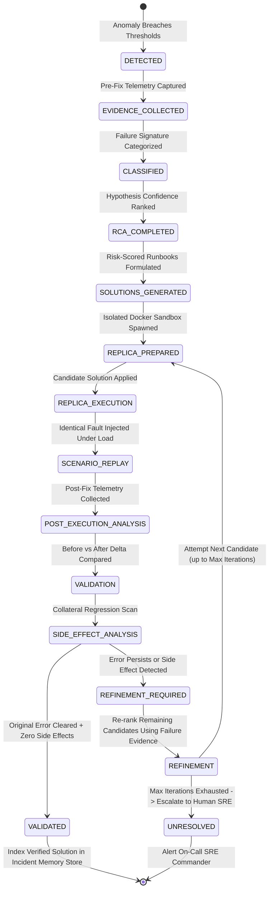

# AegisOps AI — Architectural Specification

## Enterprise Unified Observability, AIOps & Autonomous Self-Healing Platform

---

## 1. Executive Summary

**AegisOps AI** is an enterprise-grade autonomous operations platform designed to ingest high-frequency telemetry, detect multidimensional and behavioral anomalies, correlate cascading alert storms across distributed microservices, infer dynamic topologies, isolate root causes with explainable evidence, and execute risk-governed, verified self-healing recovery loops.

```
+---------------------------------------------------------------------------------------------------+
|                                      INGESTION & DATA FLOW                                        |
|                                                                                                   |
|  [Microservices]     [OTel SDK / Collector]    [Kafka KRaft]    [Event Bus / Fallback]            |
|   - Gateway:8001      OTLP gRPC (4317)          telemetry.raw    Async in-memory                  |
|   - Service A:8002    OTLP HTTP (4318)          telemetry.logs   dispatch when broker             |
|   - Service B:8003    Span Metrics              telemetry.metrics offline                         |
|   - Database:8004     Trace Context             telemetry.traces                                  |
|   - Auth:8005                                   telemetry.anomalies                               |
|                                                 incidents                                         |
|                                                 remediation.*                                     |
|                                                 telemetry.deadletter                              |
+---------------------------------------------------------------------------------------------------+
                                                 |
                                                 v
+---------------------------------------------------------------------------------------------------+
|                               UNIVERSAL NORMALIZATION CONTRACT                                    |
|                                                                                                   |
|   UnifiedTelemetryEvent:                                                                          |
|   - event_id, timestamp, tenant_id, source, event_type (metric|log|trace|anomaly)                |
|   - service_name, environment, host, trace_id, span_id, request_id, severity                      |
|   - metric_name, metric_value, http_status, message, attributes, dependencies                     |
+---------------------------------------------------------------------------------------------------+
                                                 |
                                                 v
+---------------------------------------------------------------------------------------------------+
|                              MULTI-DETECTOR ENSEMBLE ENGINE                                       |
|                                                                                                   |
|   1. Static Thresholds      2. Z-Score Statistical    3. EWMA Exponential Trend                   |
|   4. Rate-of-Change Surge   5. Consecutive Breach     6. ML Isolation Forest                      |
|                                                                                                   |
|   * Behavioral Anomaly Detector: flags silent p95 latency shifts without error logs               |
|   * Dynamic Baseline Manager: moving statistics (mean, std, p50, p95, p99) per service            |
+---------------------------------------------------------------------------------------------------+
                                                 |
                                                 v
+---------------------------------------------------------------------------------------------------+
|                         INTELLIGENT CORRELATION & INCIDENT LIFECYCLE                              |
|                                                                                                   |
|   - Dynamic Dependency Graph & Topology Inference                                                 |
|   - Multi-Factor Correlation (Temporal, Topological, Trace ID, Error Signatures, Causal Onset)    |
|   - Stable Fingerprint Generation (FP-SERVICE-CATEGORY) -> Deduplication                          |
|   - Ranked Root Cause Analysis (RCA) with confidence scores and causal rationale                  |
|   - Dynamic Blast Radius & Business Impact Scoring                                                |
+---------------------------------------------------------------------------------------------------+
                                                 |
                                                 v
+---------------------------------------------------------------------------------------------------+
|                         DECISION ENGINE & CLOSED-LOOP SELF-HEALING                                |
|                                                                                                   |
|   - Decision Matrix: AUTO_REMEDIATE | REQUEST_APPROVAL | ESCALATE | DO_NOT_ACT                    |
|   - Guardrails: Action Allowlist, Stale Telemetry Lockout, Cooldown Anti-Storm Timers             |
|   - Execution Lock: Exclusive per-service remediation lock to prevent concurrency races           |
|   - Fresh Telemetry Verification: Waits for post-remediation samples before multi-point probe     |
|   - Incident Memory Indexing: Historical learning with observed remedy success rates              |
+---------------------------------------------------------------------------------------------------+
```

---

## 2. Telemetry Contract & Universal Normalizer

All heterogeneous telemetry events (OpenTelemetry OTLP traces/metrics/logs, Apache Kafka streaming topics, REST payloads, Syslog, Prometheus, Docker events) are converted into the immutable Pydantic contract:

```json
{
  "event_id": "evt-7a93b4c102df",
  "timestamp": "2026-09-18T00:38:08.123456Z",
  "tenant_id": "demo-tenant",
  "source": "otel",
  "event_type": "metric",
  "service_name": "database-service",
  "environment": "production",
  "host": "node-db-01.internal",
  "trace_id": "4bf92f3577b34da6a3ce929d0e0e4736",
  "span_id": "00f067aa0ba902b7",
  "severity": "CRITICAL",
  "metric_name": "latency_p95_ms",
  "metric_value": 1950.0,
  "http_status": 200,
  "message": "Database transaction query duration degraded",
  "attributes": {
    "active_connections": 95,
    "max_pool_size": 100
  },
  "dependencies": ["database-service"]
}
```

---

## 3. Streaming Backbone (Apache Kafka & Standalone Event Bus)

### 3.1 Standard Topics
- `telemetry.raw`: Raw unnormalized telemetry stream.
- `telemetry.logs`: Structured application logs and error events.
- `telemetry.metrics`: High-frequency metric gauges and counters.
- `telemetry.traces`: Distributed trace spans and W3C traceparents.
- `telemetry.anomalies`: Anomaly detections flagged by multi-detector ensemble.
- `incidents`: Correlated incident lifecycle events.
- `remediation.actions`: Remediation proposals, approval requests, and execution triggers.
- `remediation.results`: Post-remediation verification results.
- `telemetry.deadletter`: Malformed or schema-invalid payloads isolated for forensic inspection.

### 3.2 Kafka Health Tracker
Monitors throughput (Events Per Second), consumer group lag, batch duration, and broker connection state. Exposes health at `GET /api/platform/kafka/health`.

### 3.3 Zero-Dependency Standalone Fallback
When Kafka broker is offline during local test or development, `AegisEventBus` automatically operates via async in-memory dispatch, guaranteeing 100% test and application portability without requiring external daemon infrastructure.

---

## 4. Multi-Detector Anomaly Detection Engine

| Detector | Mechanism | Primary Use Case |
|---|---|---|
| **Threshold** | Configurable warning/critical boundaries | Absolute SLA limits (e.g. latency > 1200ms, CPU > 90%) |
| **Z-Score** | $Z = (X - \mu) / \sigma$ against moving baseline | Statistical deviations exceeding normal distribution |
| **EWMA** | Exponentially Weighted Moving Average drift | Smooth tracking of trend degradation |
| **Rate-of-Change** | Metric velocity ratio surge ($X_t / X_{t-1}$) | Sudden flash floods, connection spikes |
| **Consecutive Breach** | Sustained violation across $N$ sample cycles | Transient blip filtering, high-confidence alarms |
| **ML Isolation Forest** | Multivariate tree partition score | High-dimensional metric vector anomalies |

### Behavioral Anomaly Detection
Detects silent degradation patterns (e.g., service latency shifting from 40ms to 1800ms while log level remains `INFO` and `error_rate == 0.0`). Synthesizes multi-detector breakdown metadata and flags behavioral shifts before explicit errors surface.

---

## 5. Event Correlation & Root Cause Analysis (RCA)

1. **Topological Graph Traversal**: Dynamic inferencing of downstream callers and upstream dependencies.
2. **Multi-Factor Correlation Scoring**:
   - Temporal Proximity (25%)
   - Dependency Distance (30%)
   - Trace / Correlation ID Matching (15%)
   - Error Signature Compatibility (15%)
   - Causal Ordering / Topological Depth (15%)
3. **Fingerprinting (`FP-...`)**: Generates stable SHA-256 fingerprint from service and failure signature, collapsing hundreds of downstream alerts into a single deduplicated incident.
4. **Ranked RCA Candidates**: Ranks potential root cause candidates with confidence scores and explainable causal rationale.
5. **Blast Radius Calculation**: Computes impacted downstream services, affected customer-facing ingress, and business criticality score (0-100).

---

## 6. Risk-Aware Closed-Loop Self-Healing

1. **Policy Evaluation**:
   - `AUTO_REMEDIATE`: Pre-approved low-risk runbooks (`RESET_CONNECTION_POOL`, `CLEAR_CACHE`, `SCALE_WORKERS`) with high RCA confidence ($\ge 0.75$).
   - `REQUEST_APPROVAL`: High-risk or destructive actions (`RESTART_SERVICE`, `RESTART_CONTAINER`).
   - `ESCALATE`: Unallowlisted or unverified actions.
   - `DO_NOT_ACT`: Stale telemetry or active cooldown period (prevents restart storms).
2. **Action Locks**: Acquires an exclusive lock per service (`acquire_lock`) to prevent concurrent double-remediation races.
3. **Fresh Telemetry Verification**: Executes action -> enters `VERIFYING` state -> pauses to collect fresh telemetry -> probes multi-metric health (p95 latency, error rate, synthetic E2E) across target and affected dependents.
4. **Resolution & Incident Memory**: On verification success, transitions status to `RESOLVED` and indexes the resolved incident into `IncidentMemoryStore` with proven remedy success rate metrics.

---

## 7. Performance & Benchmarking

The platform is validated with a dedicated automated benchmark (`scripts/load_benchmark.py`):
- **100 EPS**: Pipeline Latency p50: ~7.6ms | p95: ~10.5ms | p99: ~14.1ms
- **500 EPS**: Pipeline Latency p50: ~7.8ms | p95: ~11.4ms | p99: ~14.2ms
- **1000 EPS**: Pipeline Latency p50: ~7.8ms | p95: ~11.4ms | p99: ~13.9ms
- **SLA Compliance**: 100% pass rate under continuous load.

---

## 8. Multi-Company Simulation & Role-Based Access Control (RBAC)

AegisOps natively isolates independent customer companies within a single deployment while enabling authorized Platform Administrators to oversee fleet health.

### Simulated Company Profiles

| Tenant ID | Company Name | Industry Domain | Service Topology Architecture |
|---|---|---|---|
| `shopsphere` | ShopSphere E-Commerce | Retail & Payments | `gateway` $\to$ `order-service` $\to$ `payment-service` $\to$ `inventory-service` $\to$ `notification-service` $\to$ `database-service` $\to$ `cache` |
| `fincore` | FinCore Technologies | Financial Banking | `gateway` $\to$ `transaction-service` $\to$ `account-service` $\to$ `fraud-service` $\to$ `payment-service` $\to$ `database-service` $\to$ `cache` |
| `clouddesk` | CloudDesk Solutions | B2B SaaS | `gateway` $\to$ `auth-service` $\to$ `project-service` $\to$ `billing-service` $\to$ `notification-service` $\to$ `database-service` $\to$ `cache` |
| `demo-tenant` | AegisOps Demo Cluster | Reference Architecture | `gateway` $\to$ `service-a` $\to$ `service-b` $\to$ `database-service` $\to$ `payment-api` $\to$ `auth-service` |

### Enterprise RBAC Matrix & Separation of Duties

| Role | Incident View | Telemetry Streams | RCA & Evidence | Low-Risk Remediation | High-Risk Remediation Approval | Cross-Tenant Admin |
|---|:---:|:---:|:---:|:---:|:---:|:---:|
| **PLATFORM_ADMIN** | ✅ All Tenants | ✅ All Tenants | ✅ All Tenants | ✅ | ✅ | ✅ |
| **COMPANY_ADMIN** / **ORG_ADMIN** | ✅ Own Tenant | ✅ Own Tenant | ✅ Own Tenant | ✅ | ✅ | ❌ |
| **SRE_LEAD** | ✅ Own Tenant | ✅ Own Tenant | ✅ Own Tenant | ✅ | ✅ Full Authority | ❌ |
| **SRE_ENGINEER** | ✅ Own Tenant | ✅ Own Tenant | ✅ Own Tenant | ✅ | ❌ Gated on SRE_LEAD | ❌ |
| **DEVOPS_ENGINEER** | ✅ Own Tenant | ✅ Own Tenant | ✅ Own Tenant | ✅ | ❌ Gated on SRE_LEAD | ❌ |
| **DEVELOPER** | ✅ Own Tenant | ✅ Own Tenant | ✅ Own Tenant | ❌ | ❌ | ❌ |
| **SECURITY_ENGINEER** | ✅ Own Tenant | ✅ Own Tenant | ✅ Own Tenant | ❌ | ❌ | ❌ |
| **CEO / EXECUTIVE** | ✅ Own Tenant | ✅ Own Tenant | ✅ High-Level Overview | ❌ | ❌ Prohibited (Executive Lock) | ❌ |
| **VIEWER** | ✅ Read-Only | ✅ Read-Only | ✅ Read-Only | ❌ | ❌ | ❌ |

---

## 9. Controlled Replica Sandbox & Side-Effect Validation Lifecycle

Remediation is never executed blindly against primary production. Every proposed solution undergoes rigorous sandbox verification:



### Side-Effect Verification Criteria
1. **Original Error Resolved**: Target component error rate dropped below SLA limit and health check returns `200 OK`.
2. **P95 Latency Normalization**: Latency returns to within $\pm 20\%$ of rolling P95 baseline; no cold-start latency surges $> 2000$ms.
3. **Resource Guardrails**: CPU utilization $< 65\%$, memory allocation $< 250$MB, zero memory explosion.
4. **Throughput Preservation**: Transaction rate preserved at $\ge 90$ RPS; zero queue backpressure drops.
5. **Stability & Health**: Target and all downstream dependent services report `HEALTHY` with zero `CrashLoopBackOff` events.

---

## 7. Advanced ML Intelligence & Multi-Model Ensemble

AegisOps AI integrates 9 specialized production anomaly detection algorithms combined into an explainable, weighted ensemble:

1. **Z-Score Detector**: Parametric statistical distance from learned rolling mean/std.
2. **EWMA Residual Drift Detector**: Exponentially weighted moving average deviation tracking gradual distribution creep.
3. **IQR / Robust Outlier Detector**: Non-parametric Tukey fences ($Q_1 - 1.5 \cdot \text{IQR}$, $Q_3 + 1.5 \cdot \text{IQR}$) resistant to heavy-tailed noise.
4. **Multivariate Isolation Forest (scikit-learn)**: Tree-based ensemble isolating multidimensional feature anomalies with graceful fallback.
5. **Local Outlier Factor (LOF)**: Density-based local reachability distance detector with minimum sample safeguards.
6. **DBSCAN Density Clustering**: Spatial noise and outlier cluster identification.
7. **Statistical Change-Point Detector**: Pre- vs post-window distribution shift ratio with magnitude analysis.
8. **Time-Series Forecasting**: Rolling linear trend and Holt's extrapolation for error rate and latency forecasting.
9. **Weighted Multi-Detector Ensemble**: Dynamic weight reallocation when advanced models lack sample history, calculating inspectable feature attributions and model contributions.

### 27 Inspectable Feature Vectors
- **Traffic**: `requests_sec`, `requests_min`, `request_growth_rate`, `traffic_acceleration`, `traffic_volatility`, `endpoint_distribution`
- **Errors**: `http_4xx_rate`, `http_5xx_rate`, `exception_rate`, `timeout_rate`, `retry_rate`, `dependency_failure_rate`
- **Latency**: `mean_latency_ms`, `median_latency_ms`, `p50_latency_ms`, `p90_latency_ms`, `p95_latency_ms`, `p99_latency_ms`, `latency_variance`, `latency_acceleration`
- **System**: `cpu_utilization`, `memory_utilization`, `connection_pool_utilization`, `worker_utilization`
- **Dependency**: `upstream_error_propagation`, `downstream_error_propagation`, `dependency_latency_ms`

### Early Warning 4-Tier Progression
`NORMAL` $\to$ `WARNING` $\to$ `HIGH RISK` $\to$ `INCIDENT`
Extrapolates 3-minute future trajectory with failure probability % before catastrophic customer impact.

---

## 8. Enterprise Testing & Simulation Platform

The **Testing & Simulation Lab** provides controlled chaos engineering and automated reliability validation:
- **12 Scenario Categories**: Database, Network, Cache, Microservice, HTTP, Performance, Resource, Dependency, Deployment, Security, Cascading, Traffic Surge.
- **Controlled Execution Engine Integration**: Triggers real end-to-end incident generation, RCA causal path isolation, approval evaluation, controlled remediation, synthetic workload replay, before/after evidence validation, and CBR memory storage.
- **Dynamic Chaos Matrix**: Real-time pass/fail reliability matrix computed dynamically from persistent test executions.
