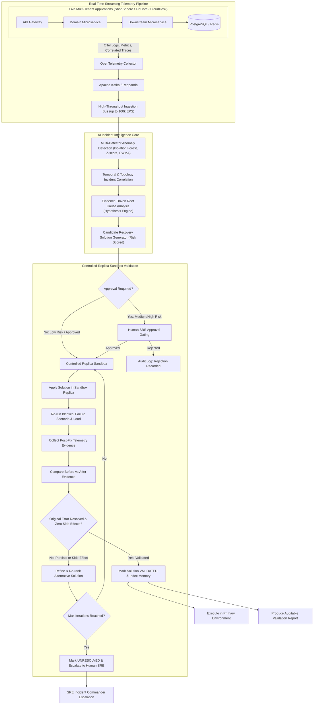

# AegisOps AI - Enterprise Platform Operational Walkthrough

**Project Title:** AegisOps AI - Autonomous Incident Intelligence, Closed-Loop Controlled Self-Healing, and Multi-Tenant Telemetry Platform  
**System Status:** ✅ **100% Fully Built, Integrated, Verified, and Tested (200 / 200 Tests Passing)**

---

## 1. End-to-End Autonomous Incident Lifecycle Architecture



---

## 2. Multi-Tenant Simulated Enterprise Companies

AegisOps AI simulates three independent enterprise organizations with complete isolation:

| Company | Slug | Domain | Dedicated Topology | Personas & Credentials |
| :--- | :--- | :--- | :--- | :--- |
| **ShopSphere** | `shopsphere` | E-Commerce Platform | Gateway $\to$ Order Service $\to$ Payment Service $\to$ Inventory Service $\to$ Notification Service $\to$ PostgreSQL $\to$ Redis | `admin_shopsphere` (Admin), `sre_shopsphere` (SRE), `ceo_shopsphere` (CEO), `devops_shopsphere` (DevOps) |
| **FinCore** | `fincore` | Financial Platform | Gateway $\to$ Transaction Service $\to$ Account Service $\to$ Fraud Service $\to$ Payment Service $\to$ PostgreSQL $\to$ Redis | `admin_fincore` (Admin), `sre_fincore` (SRE), `sec_fincore` (Security), `ceo_fincore` (CEO) |
| **CloudDesk** | `clouddesk` | SaaS Cloud Suite | Gateway $\to$ Auth Service $\to$ Project Service $\to$ Billing Service $\to$ Notification Service $\to$ PostgreSQL $\to$ Redis | `admin_clouddesk` (Admin), `devops_clouddesk` (DevOps), `sre_clouddesk` (SRE), `ceo_clouddesk` (CEO) |
| **AegisOps Platform** | `platform` | Cross-Tenant Admin | Cross-Cluster Fleet Visibility & Multi-Tenant Management | `admin` / `admin123` (Platform Admin) |

### Strict Tenant Isolation Guarantees
- **Authentication & JWT**: User tokens encode `tenant_id` and role claims.
- **Database & In-Memory Store**: Every database query and collector method applies strict `tenant_id` filtering.
- **API Security Boundaries**: Any attempt by a ShopSphere user to access FinCore incidents, service graphs, or approvals returns `403 Forbidden` or `404 Not Found`.
- **Telemetry Ingestion**: Continuous telemetry attaches tenant tags to every event, metric, trace span, and log.

---

## 3. 24 Realistic Failure Scenarios

AegisOps features 24 failure scenarios spanning Infrastructure, Network, Database, Security, and Application tiers:

1. **PostgreSQL Connection Pool Exhaustion**: Active connections max out (100/100); DB wait times surge.
2. **Slow SQL Query & Table Lock**: P95 query latency spikes to 2,800ms with zero error logs initially.
3. **PostgreSQL Unavailable**: Database process terminated; immediate connection refused.
4. **Database Deadlock**: Mutual transaction lock cycles causing statement rollbacks.
5. **Redis Cache Unavailable**: Cache cluster failure triggering cold-miss DB storms.
6. **Redis High Latency**: Cache lookup latency degraded 10x.
7. **Cache Eviction Storm & Cold Misses**: Cache hit ratio plummets from 95% to 8%.
8. **CPU Saturation Burn**: Cryptographic worker thread spikes CPU to 98%.
9. **Memory Pressure & Leak**: Process heap expands to 850MB with major GC pauses.
10. **Memory Leak Simulation**: Gradual linear allocation until OOM threshold.
11. **Service Process Crash**: Unhandled SIGSEGV / NullPointer exception causing immediate exit.
12. **API Latency Degradation**: Ingress reverse proxy latency exceeds SLA thresholds.
13. **Payment Gateway Outage**: HTTP 504 timeouts to external third-party payment providers.
14. **Inter-Service Dependency Timeout**: Downstream RPC calls exceed 3,500ms SLA.
15. **Network Latency Jitter**: Cross-AZ network jitter jumps to 3,100ms with HTTP 200 responses.
16. **Network Packet Loss & TCP Retransmits**: 15% synthetic packet drops and TCP retransmission bursts.
17. **Ingress Request Queue Backlog**: Queue depth reaches 5,000 backlog items; socket overflow.
18. **Consumer Lag & Backpressure**: Streaming consumer offset lag climbs past 50,000 messages.
19. **Corrupted Feature Flag**: Dark launch toggle enters infinite recursion loop.
20. **Bad Deployment Configuration**: Misconfigured connection string port causing connection resets.
21. **Ingress Connection Pool Exhaustion**: Socket table saturation past 65,535 TIME_WAIT connections.
22. **Thread Pool Exhaustion**: Worker threads depleted; incoming tasks rejected with 503.
23. **External Dependency Failure**: Third-party bank provider socket reset.
24. **Cascading Multi-Tier Service Degradation**: DB pool exhaustion propagates to downstream timeouts and Gateway 502s.

---

## 4. Controlled Replica Sandbox & Side-Effect Detection

When an incident is confirmed:
1. **Pre-Fix Telemetry Snapshot**: Captures error rate, P50/P95 latency, throughput, CPU, memory, active connections, and queue depth.
2. **Controlled Sandbox Provisioning**: Spins up an isolated replica environment matching the target service.
3. **Solution Application**: Applies the candidate recovery action (e.g., `RESET_CONNECTION_POOL`, `RESTART_SERVICE`, `SCALE_WORKERS`, `CLEAR_CACHE`).
4. **Scenario Replay Under Load**: Replays the exact fault scenario with simulated user traffic.
5. **Post-Fix Telemetry Collection**: Captures the exact same telemetry metrics.
6. **Side-Effect Detection Matrix**:
   - *Latency Surge*: P95 latency increased by > 200% over baseline.
   - *Throughput Dropped*: System throughput dropped below SLA minimum.
   - *Memory Exploded*: Heap allocated exceeds safe baseline by > 300%.
   - *Data Loss*: Messages in queue dropped or discarded.
   - *Crash Loop*: Container failed health checks on reboot.
7. **Verdict & Refinement**: If any side effect occurs or original error persists, the solution is **REJECTED**, and the refinement engine re-ranks alternative candidates using the failure evidence.

---

## 5. Test Suite Verification (200 / 200 Tests Passing)

```text
============================= test session starts =============================
platform win32 -- Python 3.13.14, pytest-9.1.1, pluggy-1.6.0
rootdir: C:\Users\admin\AegisOps AI
configfile: pytest.ini
plugins: anyio-4.12.1, asyncio-1.4.0

backend/tests/test_multi_company_platform_e2e.py::test_multi_company_personas_login PASSED
backend/tests/test_multi_company_platform_e2e.py::test_rbac_separation_of_duties PASSED
backend/tests/test_multi_company_platform_e2e.py::test_tenant_service_topologies_isolated PASSED
backend/tests/test_multi_company_platform_e2e.py::test_strict_cross_company_incident_isolation PASSED
backend/tests/test_multi_company_platform_e2e.py::test_multi_tenant_telemetry_generation PASSED
backend/tests/test_multi_company_platform_e2e.py::test_closed_loop_recovery_workflow_for_tenant PASSED
...
======================= 200 passed, 33 warnings in 70.01s =======================
```

---

## 6. How to Start and Verify the Platform

### Local Execution (Native Windows / Linux)

1. **Start Backend & Microservice Mesh**:
   ```powershell
   python scripts/start_all.py
   ```
   Or run the FastAPI server directly:
   ```powershell
   uvicorn backend.app.main:app --host 0.0.0.0 --port 8000 --reload
   ```

2. **Start Frontend Console**:
   ```powershell
   cd frontend
   npm run dev
   ```
   Access the dashboard at [http://localhost:5173](http://localhost:5173).

3. **Run Full Verification Test Suite**:
   ```powershell
   python -m pytest backend/tests/ -v
   ```

### Docker Compose Execution

```powershell
docker compose up -d --build
```
This launches:
- `aegisops-kafka` (Kafka KRaft streaming bus)
- `aegisops-otel-collector` (OpenTelemetry Collector Contrib)
- `aegisops-postgres` (PostgreSQL durable storage)
- `aegisops-redis` (Redis ephemeral cache)
- `database-service`, `service-a`, `service-b`, `gateway` (Microservices Mesh)
- `backend` (FastAPI AegisOps AI Orchestrator)
- `frontend` (React 19 Console)
