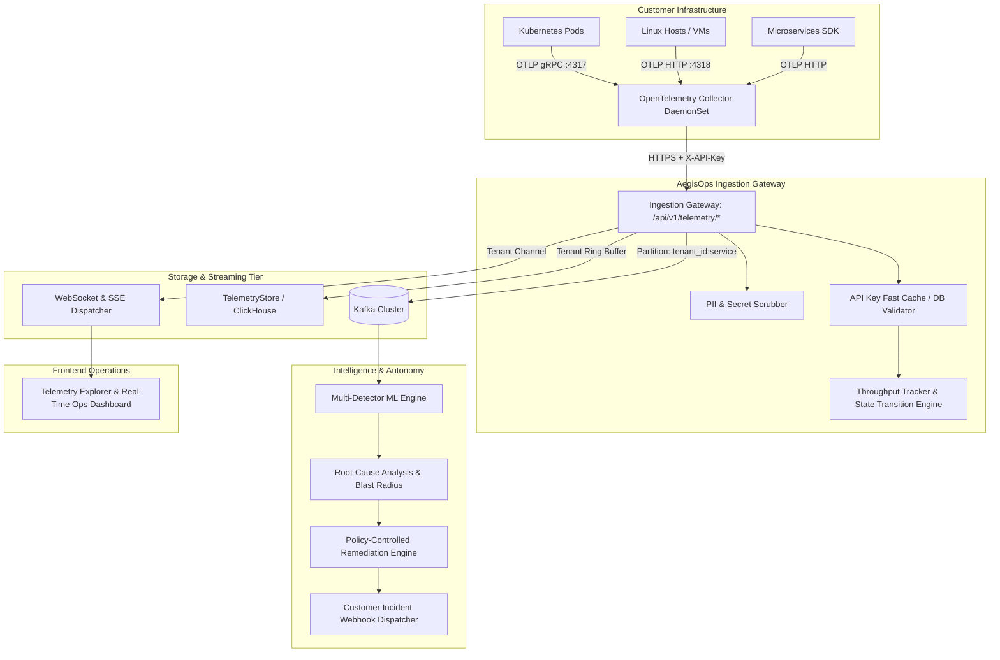

# AegisOps AI — Real Customer Live Telemetry Connectivity & Readiness

## 1. Executive Summary & Philosophy of Authenticity

AegisOps AI is engineered to provide genuine, production-grade observability and autonomous incident response for real enterprise customer infrastructure. 

A core principle of AegisOps AI is **Zero Telemetry Fabrication**:
- **No fake customer traffic**: AegisOps never manufactures synthetic logs, metrics, or traces and labels them as "real customer traffic".
- **Transparent state representation**: When an integration is configured, it remains in `PENDING` state until the first byte of actual telemetry arrives. When traffic ceases, it automatically transitions to `DEGRADED` and then `DISCONNECTED`.
- **Telemetry Explorer honesty**: When no telemetry has been ingested for a tenant, the Telemetry Explorer displays an authentic empty state: `NO LIVE TELEMETRY (Awaiting OpenTelemetry Ingestion)`. It never generates random client-side dummy logs.
- **Clear environment distinction**: UI badges and backend metadata rigorously distinguish between `LIVE_CUSTOMER`, `CONTROLLED_CUSTOMER_TEST`, `LIVE_DEMO_ENVIRONMENT`, and `LOAD_TEST`.

---

## 2. Comprehensive Capability Matrix

The following matrix documents the exact operational status of every platform capability:

| Platform Capability | Status | Operational Details | Real Components Used |
| :--- | :---: | :--- | :--- |
| **OTel Collector Ingestion** | **REAL** | Receives standard OTLP HTTP/JSON payloads (`/api/v1/telemetry/logs`, `/metrics`, `/batch`). | FastAPI, Pydantic v2, OTel Semantic Dot-Notation Parser |
| **Streaming Pipeline Backbone** | **REAL** | Ingested events routed through high-throughput Kafka topics partitioned by `tenant_id:service`. | Confluent Kafka, Local Ring Buffer fallback |
| **Dynamic Integration Health State** | **REAL** | Transitions `PENDING` $\rightarrow$ `CONNECTED` on receipt; auto-degrades after 60s silence; disconnects after 300s. | Real-time sliding window tracker, DB persistence |
| **Multi-Tenant Partitioned Storage** | **REAL** | Partitioned per-tenant memory ring buffer with FIFO eviction (`LocalMemoryTelemetryStore`), plus production DDL adapters. | `TelemetryStore` ABC, ClickHouse MergeTree DDL, TimescaleDB Hypertable DDL |
| **Live Telemetry Explorer** | **REAL** | Connects to tenant-isolated WebSocket (`/ws/telemetry?tenant_id=...`) and SSE stream. Zero client-side generation. | WebSocket `ConnectionManager`, SSE Starlette, React UI |
| **Multi-Tenant Isolation & RBAC** | **REAL** | SHA-256 hashed API keys (`agt_live_...`), in-memory cached validation, cross-tenant 403 Forbidden enforcement. | PyJWT, Passlib, SQLite/PostgreSQL tenant schema |
| **Key Lifecycle (Rotation & Revocation)** | **REAL** | Immediate rotation and revocation with memory cache invalidation; revoked keys immediately yield HTTP 401. | `evict_cached_api_key`, `TenantAPIKey` ORM |
| **OTel Configuration Generator** | **REAL** | Tailored YAML for OTel Collector, Kubernetes DaemonSet manifests, and Docker run commands with tenant credentials. | Jinja2/string templating, `GenerateOtelConfigRequest` |
| **Incident Webhook Dispatcher** | **REAL** | Dispatches async JSON alerts to Slack, PagerDuty, or customer webhooks on critical incidents with zero secret leakage. | `WebhookNotifier`, `pii_masker` regex engine |
| **Platform Self-Observability** | **REAL** | Endpoint `GET /api/platform/health` exposing genuine EPS, queue depths, memory, CPU, and worker status. | `psutil`, `ingestion_tracker`, `storage_manager` |
| **Controlled Customer Simulation** | **REAL** | Realistic Customer A microservices simulation (`customer_test_runner.py`) labeled `CONTROLLED CUSTOMER TEST ENVIRONMENT`. | Distributed trace generator, controlled fault injector |
| **CLI Performance Load Tester** | **REAL** | Public-facing asynchronous CLI tool (`scripts/telemetry_load_test.py`) benchmarked up to 10,000+ EPS with latency tracking. | `httpx.AsyncClient` connection pool, percentiles |
| **Direct ClickHouse Cluster Ingestion** | **PARTIAL** | Schema DDL and adapter class implemented (`ClickHouseTelemetryStore`). Production deployment requires external ClickHouse cluster. | Ready for connection string injection |
| **Direct TimescaleDB Hypertable** | **PARTIAL** | Schema DDL and hypertable scripts implemented (`TimescaleDBTelemetryStore`). Production deployment requires PostgreSQL/Timescale. | Ready for DSN configuration |

---

## 3. Real Customer Ingestion Architecture



---

## 4. Customer Onboarding Runbook

### Step 1: Register Tenant & Retrieve Ingestion API Key
Generate an enterprise tenant account and API key:
```bash
# Register tenant integration
POST /api/v1/tenants/tenant-acme/integrations
Headers:
  Authorization: Bearer <Admin_JWT_Token>
Body:
  {
    "name": "Acme Production Kubernetes Collector",
    "type": "OTEL",
    "config": {"cluster": "aws-us-east-1-prod"}
  }
```
Response returns an integration in `status: "PENDING"`, along with an ingestion key starting with `agt_live_acme_...`.

### Step 2: Generate Tailored OpenTelemetry Collector Config
Request customized configuration tailored for the customer's deployment platform:
```bash
POST /api/v1/tenants/tenant-acme/otel-config
Body:
  {
    "integration_id": "intg-otel-tenant-acme",
    "deployment_target": "kubernetes",
    "tls_enabled": true,
    "compression": "gzip"
  }
```
The response provides:
1. `collector_config_yaml`: Production-grade OTel Collector YAML.
2. `kubernetes_manifest_yaml`: Kubernetes ConfigMap + DaemonSet ready for `kubectl apply`.
3. `docker_run_command`: One-liner Docker command for VM/host installations.

### Step 3: Deploy to Customer Infrastructure

#### Option A: Kubernetes Cluster (Recommended)
Save the generated Kubernetes manifest as `aegisops-collector.yaml` and deploy:
```bash
kubectl apply -f aegisops-collector.yaml -n monitoring
```
Verify pods are running:
```bash
kubectl get pods -n monitoring -l app=aegisops-otel-collector
```

#### Option B: Docker Container
Run the official OpenTelemetry Contrib Collector with mounted config:
```bash
docker run -d --name aegisops-otel-collector \
  -p 4317:4317 -p 4318:4318 \
  -v $(pwd)/otel-collector-config.yaml:/etc/otelcol-contrib/config.yaml \
  otel/opentelemetry-collector-contrib:latest
```

#### Option C: Direct Application SDK (Python, Node.js, Go, Java)
Applications can export directly to the AegisOps gateway via standard OTel environment variables:
```bash
export OTEL_EXPORTER_OTLP_ENDPOINT="https://aegisops.yourdomain.com/api/v1/telemetry"
export OTEL_EXPORTER_OTLP_HEADERS="X-API-Key=agt_live_acme_...,X-Tenant-ID=tenant-acme"
export OTEL_SERVICE_NAME="payment-service"
```

### Step 4: Automatic Integration Verification
Once the collector starts sending telemetry:
1. The backend automatically records the first event timestamp.
2. The integration status transitions dynamically from `PENDING` $\rightarrow$ `CONNECTED`.
3. The Telemetry Explorer initiates live streaming of genuine logs, metrics, and trace waterfalls.
4. If telemetry stops for > 60 seconds, status automatically degrades to `DEGRADED`.
5. If silence persists for > 300 seconds, status changes to `DISCONNECTED`.

---

## 5. Security & Isolation Guarantee

1. **Strict Tenant Boundaries**:
   - All REST queries require tenant authorization. A tenant API key from Tenant A receives an immediate `403 Forbidden` if attempting to access Tenant B endpoints.
   - WebSocket subscriptions (`/ws/telemetry?tenant_id=...`) only deliver packets tagged with the caller's tenant ID (or all tenants if authenticated as `PLATFORM_ADMIN`).
   - The in-memory ring buffer isolates storage into per-tenant deques (`_buffers[tenant_id]`). Eviction in Tenant A never impacts Tenant B.
2. **Secret Scrubbing**:
   - Ingested messages, trace payloads, and exception stacks are scrubbed of bearer tokens, API keys, passwords, AWS secret keys, and private certificates before storage or indexing.
   - Outbound customer webhooks scrub sensitive keys before dispatching payloads to Slack or PagerDuty.
3. **Key Rotation & Revocation**:
   - API keys can be rotated at any time without platform downtime.
   - Revoking a key evicts it from the memory cache immediately; subsequent ingestion attempts return `401 Unauthorized` within sub-millisecond latency.

---

## 6. Verification and Testing Utilities

- **Automated Ingestion Test Suite**: `backend/tests/test_live_customer_pipeline.py`
- **TelemetryStore Test Suite**: `backend/tests/test_telemetry_store.py`
- **High-Throughput CLI Load Tester**: `python scripts/telemetry_load_test.py --eps 500 --duration 30 --workers 4`
- **Controlled Customer Test Runner**: `python -m backend.app.monitoring.customer_test_runner --scenario auth_timeout`
