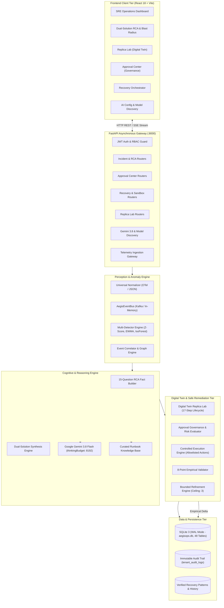
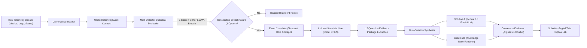
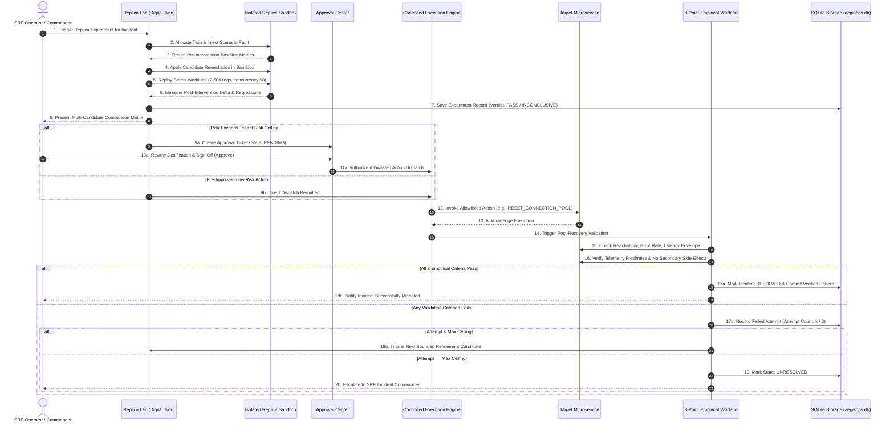
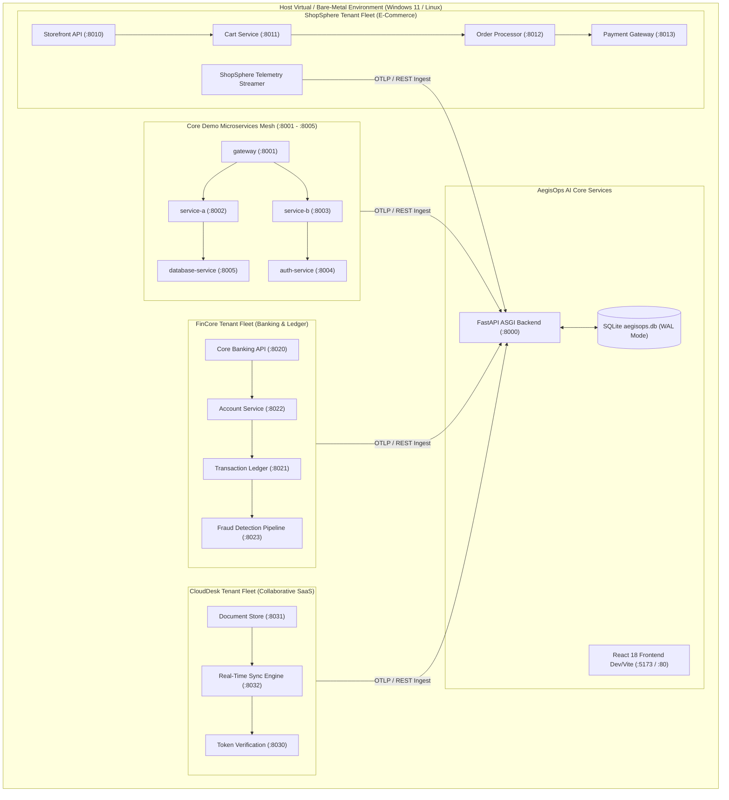
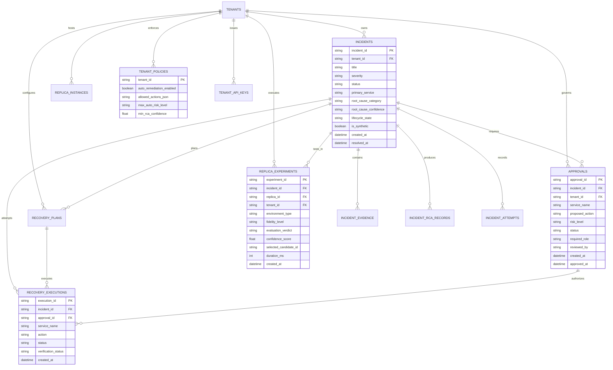

# AegisOps AI — Architectural Diagrams & Visual Specifications

This document contains report-ready Mermaid architectural diagrams illustrating the core subsystems of AegisOps AI.

---

## 1. High-Level System Architecture

---

## 2. Detailed Incident-Processing Data Flow

---

## 3. Recovery and Validation Sequence Diagram

---

## 4. Multi-Tenant Microservice & Deployment Topology

---

## 5. Entity Relationship Diagram (Database Schema)

